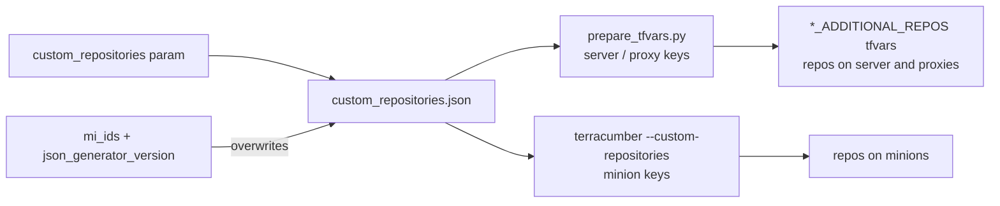

# BV hub testing: how to run it and how custom repositories reach the hub

Jobs: `manager-5.1-qe-hub-testing`, `manager-5.2-qe-hub-testing`, `manager-head-qe-hub-testing`.
Pipeline: `environments/common/pipeline-hub-build-validation.groovy`.
Topology (5.1): `hub`, `prh1`, `prh2`, `proxy`, `proxy3` run on SL Micro (transactional);
`proxy2` and the monitoring server run on SLES (non transactional); plus 4 minions
(`sles15sp7`, `slmicro61`, `ubuntu2404`, `rocky10`).

## Two ways to start a hub run

| | Who starts it | Custom repositories |
|---|---|---|
| A. From BV | BV job with `enable_hub_stages=true` | forwards its own `custom_repositories`, `mi_ids`, `json_generator_version` (one variant only, see below) |
| B. Directly | you, on `manager-<ver>-qe-hub-testing` | whatever you paste in `custom_repositories` |

A. The hub job name is derived from the BV job name (`manager-5.1-sles-qe-build-validation`
becomes `manager-5.1-qe-hub-testing`). It is triggered at the start of the BV run with `wait: false`,
so a hub failure never turns the BV build red; look at the hub build itself.
It needs a BV job named `manager-(head|X.Y)-...`; the sandbox BV job does not match.

## What `custom_repositories` is

One JSON file, `custom_repositories.json`, read by two consumers:



| Key in the JSON | Consumer | Result |
|---|---|---|
| `server`, `proxy` | `prepare_tfvars.py` | `SERVER_ADDITIONAL_REPOS`, `PROXY_ADDITIONAL_REPOS` (all instances) |
| `server_transactional`, `server_non_transactional` (same for `proxy`) | `prepare_tfvars.py` | `*_ADDITIONAL_REPOS_TRANSACTIONAL` / `_NON_TRANSACTIONAL`; replace the flat key |
| `<host>_minion` (e.g. `sles15sp7_minion`) | terracumber | repos pushed to that minion |

Rules that explain most surprises:

1. `custom_repositories` and `mi_ids` are NOT merged. If `mi_ids` is set, the generated file
   replaces whatever you pasted. Use one of the two.
2. `mi_ids` runs the generator once, for one `json_generator_version` (`51-sles` or `51-micro`).
   BV forwards its own version, so a hub started from the SLES BV gets SLES-flavoured
   `server`/`proxy` repos, wrong for the micro hub and prh servers.
3. A hub has both variants, so it needs the split keys. `merge_hub_repositories.py`
   builds them from the two generator outputs (details:
   `scripts/json_generator/merge_hub_repositories_README.md`). **No pipeline calls it yet**: the merge is manual.
4. `mi_ids` empty and `custom_repositories` `{}` means no extra repos (a valid run, released packages only).

## Shortcut: generate the file from the Jira tickets

`scripts/json_generator/hub_release_repositories.py` does the steps below for 5.1 and 5.2 in one go. It reads
the MIs of the MSQA ticket(s) (needs `JIRA_API_TOKEN`), runs the generator for `-sles` and `-micro`, merges, and writes
`hub-5.1-custom_repositories.json` / `hub-5.2-custom_repositories.json`.

```bash
cd jenkins_pipelines/scripts/json_generator
# synchronised release: 5.1 MU ticket + 5.2 ticket
python3 hub_release_repositories.py --jira MSQA-1061 MSQA-1062 \
    --slfo-pr 5.1=372,9672,9674,9675,9676 --proxy-pr-from 5.1=slmicro61_minion
# only the 5.2 client tools, on both releases
python3 hub_release_repositories.py --jira MSQA-1062
# no Jira: MI ids by hand
python3 hub_release_repositories.py --mi-ids 46932 47441 --releases 5.1
```

The 5.1 file gets the MIs of every ticket, the 5.2 file those of the 5.2 tickets. `--dry-run` shows the plan without
touching IBS. SLFO PR ids are not in the Jira description: give them with `--slfo-pr`. `--proxy-pr-from` copies the SL Micro
PR from a minion key onto the micro proxy (it does not go on the server). The manual steps follow.

## Run hub testing for 5.1.6 (manual merge)

Run on a host with python3 >= 3.10 and IBS access (`jenkins-agent` has both), from
`jenkins_pipelines/scripts/json_generator/`:

```bash
MI_IDS="12345 12346"   # the 5.1.6 MI ids, space separated

python3 maintenance_json_generator.py --version 51-sles  --mi_ids $MI_IDS
mv custom_repositories.json sles.json
python3 maintenance_json_generator.py --version 51-micro --mi_ids $MI_IDS
mv custom_repositories.json micro.json

python3 merge_hub_repositories.py --sles sles.json --micro micro.json --output hub.json
python3 -c 'import json; d=json.load(open("hub.json")); print(sorted(d))'
```

Check the printed keys: `server_transactional`, `server_non_transactional`, `proxy_transactional`,
`proxy_non_transactional`, plus the minions of the topology
(`sles15sp7_minion`, `slmicro61_minion`, `ubuntu2404_minion`, `rocky10_minion`).
A `WARNING ... differs between the sles and micro runs` line means a minion key got different
repos in the two runs; the micro one is kept.

Then in Jenkins, `manager-5.1-qe-hub-testing`, Build with Parameters:

| Parameter | Value |
|---|---|
| `custom_repositories` | content of `hub.json` |
| `mi_ids` | empty (rule 1) |
| `json_generator_version` | empty |
| `cucumber_ref` | `Manager-5.1` (default) |
| `must_deploy_hub` | true for a fresh run |
| other `must_*` / `enable_*` | defaults; untick stages to shorten a first try |

After the deploy, confirm the repos landed: on `hub` and `proxy2`, `zypper lr -u` (or
`transactional-update` repo list on micro) must show the MI repos, SLES for `proxy2`, micro for the others.

## Known gaps

- Merge is not automated: the pipeline should run the generator for both variants and call the merge
  script when `mi_ids` is set.
- A BV run with `enable_hub_stages` forwards one variant only (rule 2).
- `merge_hub_repositories.py` writes no flat `server` / `proxy` key. The testsuite falls back to the flat
  `proxy` key for the proxy custom channel (`proxy_flavour.rb`), so check that scenario on a hub run.
